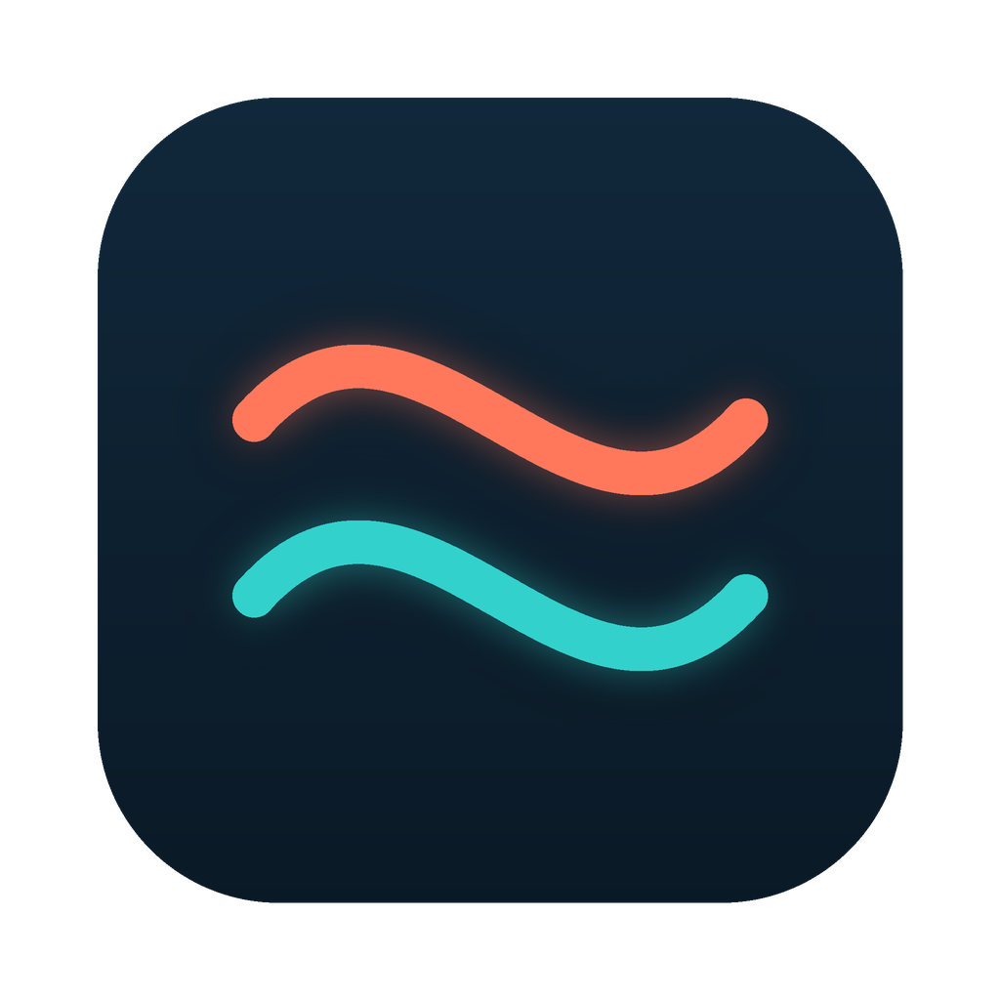

<p align="center">
  
</p>

<h1 align="center">Driftline</h1>
<p align="center"><b>by <a href="https://apavin.com/driftline">Apavin</a></b><br>
Your internet speed, live in the Mac menu bar. Free and open source.</p>

<p align="center">
  <a href="https://apavin.com/driftline/download"><b>⬇ Download for Mac</b></a> ·
  <a href="https://apavin.com/driftline">Website</a> ·
  <a href="../../releases">All releases</a>
</p>

---

## Features

- **Live speed, every second.** Upload and download speed in the menu bar, read straight from macOS's own network counters, the same numbers Activity Monitor uses. Choose a stacked, inline or download-only layout, in bits (Mb/s) or bytes (MB/s).
- **Live dashboard.** A smooth 90-second graph, peak speeds, and data sent and received this session.
- **Speed test.** Ping, jitter, and multi-stream download and upload, measured against Cloudflare's global network.
- **Keep Awake.** Stop your Mac sleeping for 15m to 8h, until a set time, or **until your downloads finish**. You can let the display sleep while the Mac keeps running, and it stops automatically at 20% battery. Right-click the menu bar item to toggle it.
- **Friends.** Link Macs with a 6-character room code. Your friend's character sits on your desktop and acts out gestures you send each other: wave, heart, high five, coffee break and more.
- **History.** Your last 25 speed tests, saved on your Mac.
- Lightweight: native Swift, no Dock icon, almost no CPU use.

## Install

1. Download **Driftline.zip** from the [latest release](../../releases/latest) (or [apavin.com/driftline](https://apavin.com/driftline)).
2. Unzip it and drag **Driftline** into **Applications**.
3. Open it. The first time, macOS may say it can't verify the developer, because Driftline isn't distributed through the App Store. Go to **System Settings → Privacy & Security**, scroll down and click **Open Anyway**. Or run this once in Terminal:
   ```bash
   xattr -cr /Applications/Driftline.app
   ```

Requires **macOS 13 Ventura or later**, on Apple silicon or Intel.

## Build from source

You only need Apple's free command line tools (`xcode-select --install`):

```bash
git clone https://github.com/vinayak0920/driftline.git
cd driftline
bash build.sh --install
```

## How it works

| Part | What it does |
| --- | --- |
| `Sources/NetStats.swift` | Reads 64-bit per-interface byte counters from the kernel (`sysctl NET_RT_IFLIST2`). It skips VPN tunnels and virtual interfaces so traffic isn't counted twice. |
| `Sources/SpeedTester.swift` | Ping from the measured round-trip time minus the server's processing time, plus parallel download and upload streams with a 2-second warm-up discarded. |
| `Sources/AwakeController.swift` | Keep Awake through standard macOS power assertions (the same mechanism `caffeinate` uses). |
| `Sources/Friends.swift`, `Buddy.swift` | Friends rooms over a WebSocket, and code-drawn animated characters. |
| `relay/` | The Cloudflare Worker that links Friends rooms: one Durable Object per room, using WebSocket hibernation. |

## Privacy

- Live speed and Keep Awake run entirely on your Mac.
- The speed test only talks to `speed.cloudflare.com`.
- Friends sends only your display name, chosen character, color and gestures to the relay, and only to people in your room. Nothing is stored. Anyone with a room code can join that room, so share codes only with people you know.

## Run your own Friends relay

Friends uses a free Cloudflare Worker. To host your own:

```bash
cd relay
npm install
npx wrangler login
npx wrangler deploy
```

Then build with your URL: `RELAY_URL=https://driftline-relay.<you>.workers.dev bash build.sh --install`.

## Releasing (maintainers)

Push a version tag. GitHub Actions builds the universal app and attaches `Driftline.zip` to a new release:

```bash
git tag v1.0.1 && git push origin v1.0.1
```

---

Made by [Apavin](https://apavin.com) · More [free tools](https://apavin.com/free-tools) · MIT License
